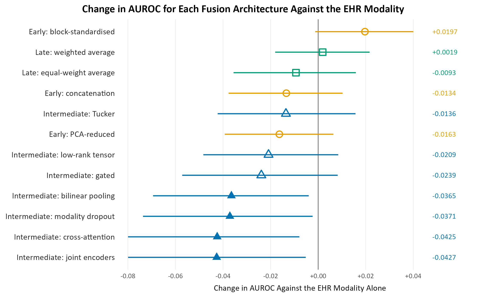
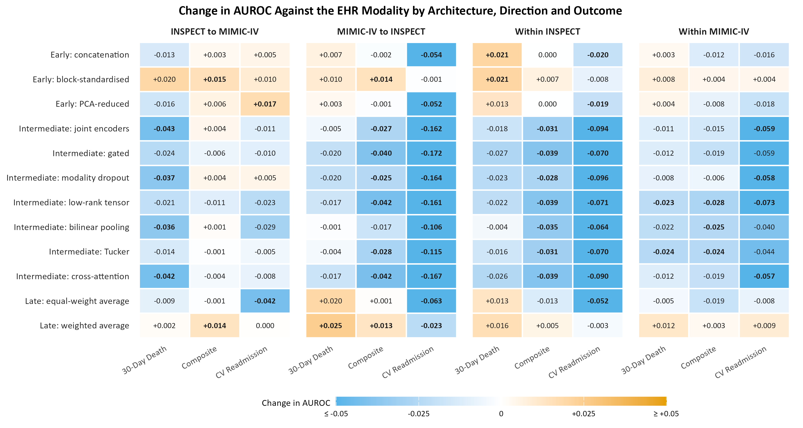
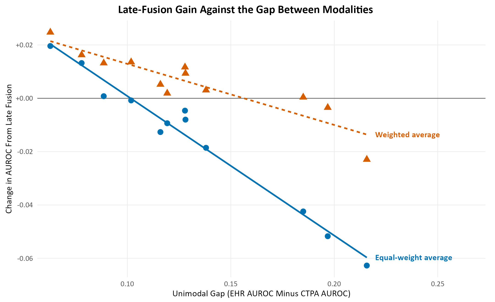
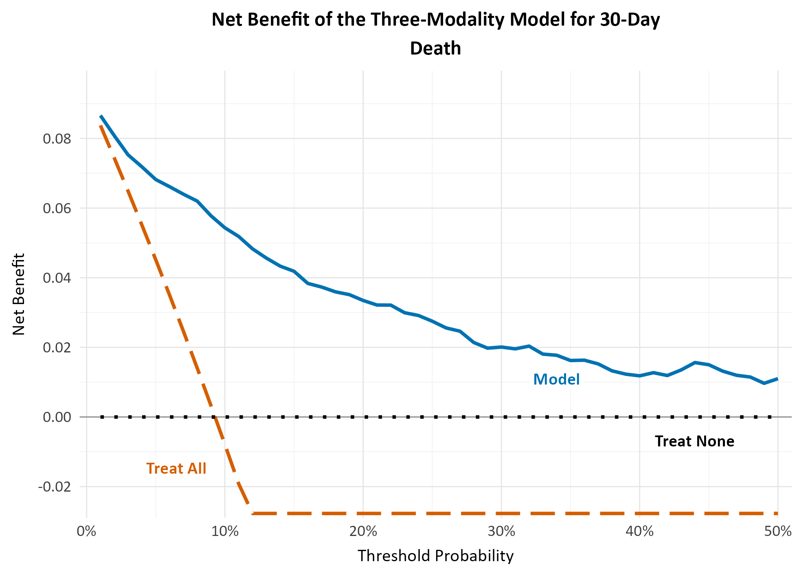

# Bidirectional Transfer and Multimodal Fusion for Prognosis After Pulmonary Embolism

This is a post-dissertation side project from 2026 that extends the MSc Data Science dissertation held in [pe-multimodal-prognosis-msc](https://github.com/andmahoff/pe-multimodal-prognosis-msc).

The repository holds the analysis code, the R figure scripts and the aggregate result tables, which are shared for transparency and reproducibility. However, it is research code rather than a maintained software package.

**Part of a three-project series on prognosis after acute pulmonary embolism (PE):**

| Part | Repository | Question |
|---|---|---|
| 1 | [pe-multimodal-prognosis-msc](https://github.com/andmahoff/pe-multimodal-prognosis-msc) | MSc dissertation. Does late fusion of EHR, ECG, CTPA report and CXR features improve the prediction of 30-day outcomes after PE? |
| 2 | **pe-fusion-transfer** (this repository) | Which fusion methods still help when models move between hospitals, in both directions between Stanford INSPECT and MIMIC-IV? |
| 3 | [pe-survival-prognosis](https://github.com/andmahoff/pe-survival-prognosis) | The MIMIC-IV cohort as time-to-event data: risk of death and readmission at any point up to one year, from diagnosis and from discharge. |

## Summary

The dissertation combined several modalities by late fusion to predict outcomes after acute pulmonary embolism (PE), and this project asks three follow-up questions of that work.

1. **Which fusion family works across hospitals?** Models using EHR and CTPA report features were trained at one hospital and applied to another without target labels, in both directions between Stanford INSPECT and MIMIC-IV. These transfer results were set against training and testing within each site, and early, intermediate and late fusion were compared using 3 early, 7 intermediate and 2 late variants.
2. **What predicts when fusion helps?** The gain from fusion was related to the AUROC gap between the two modalities.
3. **Can a tree ensemble fuse EHR, ECG and CTPA better than late fusion?** A block-stratified random forest was built on the MIMIC-IV three-modality cohort and validated with nested cross-validation.

The primary contrast was fixed before any modelling: early against intermediate against late fusion of EHR and CTPA, trained on INSPECT and evaluated on MIMIC-IV, for 30-day death. Therefore, every other analysis is secondary and exploratory.

**In brief:**
1. **Across hospitals, simple fusion is the most that helps.** On the primary contrast, no fusion architecture beat the EHR modality alone. However, across all four directions and three outcomes, block-standardised early fusion and weighted late fusion gave modest gains, while intermediate fusion never helped.
2. **The gap between modalities predicts the gain.** The narrower the AUROC gap between the two modalities, the larger the late-fusion gain (r = -0.986).
3. **Within one hospital, a tree ensemble does better.** A block-stratified random forest over EHR, ECG and CTPA reached nested cross-validated AUROCs of 0.905 for in-hospital death and 0.897 for 30-day death. In a non-nested comparison, it also beat weighted late fusion significantly on three of four outcomes.
4. **It re-tested the dissertation.** The gap rule generalised the dissertation's finding that fusion helps least when one modality dominates. However, the dissertation's small transfer cost for CTPA report text did not reproduce (see [How this builds on the dissertation](#how-this-builds-on-the-dissertation)).

## Cohorts

| Cohort | Size | Used for |
|---|---|---|
| INSPECT, EHR and CTPA | 3,300 patients | the transfer grid, as source or target |
| MIMIC-IV, EHR and CTPA | 1,649 admissions | the transfer grid, as source or target |
| MIMIC-IV, EHR, ECG and CTPA | 1,636 admissions | the three-modality models, including the final model |
| MIMIC-IV, EHR and ECG | 3,501 admissions | EHR and ECG models, and the missing-CTPA analyses |

In INSPECT and MIMIC-IV respectively, 30-day death had 246 and 152, the 30-day composite had 505 and 219, and cardiovascular readmission had 288 and 76 events.

## Key results

**Primary contrast (INSPECT to MIMIC-IV, 30-day death).** No fusion architecture was significantly better than the EHR modality alone (AUROC 0.8460), since even block-standardised early fusion, with the largest gain of +0.0197, had an interval (-0.0012 to +0.0400) that includes zero. However, four intermediate variants were significantly worse than the EHR modality, including plain joint encoders at 0.8026 (-0.0427).

  

*Change in AUROC against the EHR modality alone for each of the 12 fusion architectures, from INSPECT to MIMIC-IV for 30-day death, with filled points marking 95% intervals that exclude zero.*

**Across all four directions and three outcomes:**

- Intermediate fusion was never significantly better than the EHR modality in any of its 84 cells (7 variants by 12 direction-outcome cells). It was also significantly worse in 40 of them, including the low-rank tensor, bilinear, Tucker and cross-attention variants.
- Block-standardised early fusion and weighted late fusion were each positive in 10 of 12 cells, of which 3 were significant. For example, the largest single gain was weighted late fusion from MIMIC-IV to INSPECT on 30-day death, at +0.0248 (+0.0132 to +0.0365).

  

*Change in AUROC against the EHR modality for every architecture, transfer direction and outcome, where bold values have intervals that exclude zero. However, the colour scale stops at plus or minus 0.05, while the printed values show the full change.*

**The gap rule.** The narrower the AUROC gap between the two modalities, the larger the late-fusion gain. For example, across the 12 direction-outcome cells the correlation was r = -0.986 for equal-weight late fusion and r = -0.906 for weighted late fusion. Across the 12 modality pairings of the three-modality cohort the correlation was r = -0.902, and all three have p < 0.001.

  

*Late-fusion gain against the unimodal gap (EHR AUROC minus CTPA AUROC), across the 12 direction-outcome cells, with a fitted line for each late-fusion rule.*

**Calibration by fusion family.** Weighted late fusion was the best calibrated, with a median calibration slope of 0.86 (range 0.72 to 1.28). However, intermediate fusion was badly over-confident (median 0.21), and block-standardised early fusion was under-confident (median 1.51).

**Final three-modality model.** The final model is a block-stratified random forest on EHR, ECG and CTPA features, trained and tested within MIMIC-IV on the 1,636 admissions with all three modalities. Firstly, in a block-stratified forest each tree draws a fixed number of columns from each modality rather than a random draw from all of them. Therefore, the strong EHR block cannot crowd out the weaker ECG and CTPA blocks. Secondly, the columns also include canonical-correlation variates that link each pair of modalities. Finally, the figures below come from nested cross-validation, in which the tuning is repeated inside each outer fold.

| Outcome | Nested-CV AUROC | Optimism removed | Net benefit above treat-all and treat-none |
|---|---|---|---|
| In-hospital death | 0.9046 | 0.0115 | thresholds 1% to 48% |
| 30-day death | 0.8973 | 0.0043 | thresholds 1% to 50% |
| Composite (30 days) | 0.8537 | 0.0080 | thresholds 1% to 50% |
| Cardiovascular readmission | 0.8190 | 0.0024 | thresholds 1% to 36% |

After Platt scaling, the calibration slopes of the final model were 0.92 to 0.96. The tuned settings form a plateau rather than a sharp optimum, since 29 of 32 draw-by-regularisation combinations were statistically tied with their outcome's best.

The block forest was also compared with weighted late fusion of the same three modalities on the same admissions, using the non-nested figures for both models. It gained +0.0423 on in-hospital death, +0.0189 on 30-day death and +0.0098 on the composite, each with a paired bootstrap interval excluding zero. However, on cardiovascular readmission the gain was +0.0072, with an interval including zero.

  

*Decision curve for 30-day death, showing the net benefit of the final three-modality model against treating all patients and treating none, with the curves for the other three outcomes in `figures/`.*

**Other findings:**

- Training the CTPA modality on INSPECT and applying it zero-shot to MIMIC-IV cost 0.010 to 0.081 AUROC against training within MIMIC-IV on the same 38 features.
- Using the 1,865 admissions without a CTPA report for training, with CTPA left missing, did worse than ignoring CTPA altogether on all four outcomes (-0.0058 to -0.0266).
- Rotation forests gave no significant gain over the plain block forest, as every paired bootstrap interval spanned zero.
- Evidential (Dempster-Shafer) fusion did not beat weighted rank averaging with any of its four ignorance strategies.

## How this builds on the dissertation

This project started by rebuilding the dissertation's EHR and CTPA modalities and reproducing its main result, and it then re-tested three of the dissertation's conclusions.

- **Reproduction.** Rerun on about 1,635 admissions, the dissertation's three-modality model reached an AUROC of 0.8720 for 30-day death, against 0.8715 in the dissertation. However, the ECG added only 0.0002 to the EHR and CTPA, where the dissertation reported 0.0081.
- **The gap mechanism (confirmed).** The dissertation showed the fusion gain shrinking as it strengthened the EHR modality by design. Here the same pattern held across the natural variation of 4 train and test directions and 3 outcomes, as the gap rule above shows.
- **Fusion rules (partly confirmed).** As in the dissertation, neural fusion did not help, since intermediate fusion was never significantly better than the EHR alone in 84 cells. However, the dissertation found no combination rule significantly better than weighted rank averaging. Here, a feature-level block-stratified forest beat it within MIMIC-IV on three of four outcomes, although only in a non-nested comparison.
- **CTPA transfer (not reproduced).** In the dissertation, the CTPA modality trained on INSPECT lost 0.0175 AUROC for 30-day death against one trained within MIMIC-IV, and nothing on the composite. With the two models compared on the same 38 features and 1,636 admissions, the cost here was 0.081 for 30-day death and 0.072 for the composite. The INSPECT-trained model scored 0.691 for 30-day death against 0.741 in the dissertation, and the reason for the difference was not established. However, the dissertation's fused models used a CTPA modality trained within MIMIC-IV, so they are unaffected.

## Data access

This repository contains no patient data, no patient-level derived files (predictions, feature matrices, labels) and no fitted models. Models trained on MIMIC-IV count as derived data under the PhysioNet data use agreement, so they cannot be shared here.

Reproducing the analyses requires independent access to the following sources:

- MIMIC-IV, MIMIC-IV-ED, MIMIC-IV-Note and MIMIC-IV-ECG (PhysioNet credentialed access), with script 03 reading MIMIC-IV through BigQuery
- INSPECT (Stanford AIMI, via Redivis, under the Stanford data use agreement), for the CTPA impressions, labels and EHR condition flags
- the PTB-XL benchmark model published by Strodthoff et al. (2020), used for the ECG modality
- the derived files produced by the dissertation pipeline in [pe-multimodal-prognosis-msc](https://github.com/andmahoff/pe-multimodal-prognosis-msc), which this project starts from

## What is in this repository

| Folder | Contents |
|---|---|
| `scripts/` | Python analysis scripts, numbered in the order they were written, plus the shared module `fusion_lib.py` |
| `R/` | R scripts for the figures in this README |
| `results/` | Aggregate result tables, one row per model, outcome or cell |
| `figures/` | The PNG images shown in this README |

`results/evidential.csv` and `results/evidential_mass.csv` come from an earlier version of script 94, which computed the Brier score on percentile ranks, and `94_evidential_fixed.py` describes the correction.

## Running the code

The scripts ran on a Windows laptop and should each be run from the project folder, the one that contains `scripts/`, because they read and write `data/processed/` relative to it.

**Environments.** Each script's header names the environment it needs, and the four environments are listed in the table below.

| Environment | Used by | Requirements file |
|---|---|---|
| `venv` (analysis) | most scripts | `requirements.txt` |
| `venv_ecg` | ECG download, waveform measurements and PTB-XL feature extraction | `requirements-ecg.txt` |
| `venv_nlp` | transformer embeddings of CTPA text (script 15) | `requirements-nlp.txt` |
| `venv_dl` | INSPECT download from Redivis (scripts 01 and 02) | `requirements-download.txt` |

The analysis environment uses Python 3.11 and the CPU build of PyTorch. Therefore, installing `torch==2.5.1+cpu` from `requirements.txt` needs `--extra-index-url https://download.pytorch.org/whl/cpu` added to the `pip install` command.

**Environment variables:**

| Variable | Used by | Purpose |
|---|---|---|
| `PE_DISS_DIR` | `fusion_lib.py` and several scripts | folder holding the dissertation's derived files; defaults to `../Dissertation` |
| `GCP_PROJECT_ID` | script 03 | Google Cloud project with PhysioNet BigQuery access |
| `REDIVIS_API_TOKEN` | scripts 01 and 02 | Redivis access token for INSPECT |
| `TABPFN_TOKEN` | script 107 | TabPFN access token |

Script 41 prompts for a PhysioNet password when it runs, although nothing is stored. In addition, scripts 58 and 61 expect the PTB-XL benchmarking outputs at `~/ecg_ptbxl_benchmarking/output/exp0/`, while scripts 50, 51 and 59 read PTB-XL checkpoints saved by the dissertation under `PE_DISS_DIR/HPC`.

**R figures.** The R scripts use ggplot2, dplyr, ragg, systemfonts and scales, and they read their tables from `Documents/Data Science/SideProject/data/processed` and save images to `Documents/Data Science/SideProject/R Graphs`, both under the Windows user profile. Therefore, running a script elsewhere means changing `data_dir` and `fig_dir` at its top, and the tables it needs can be found in `results/`.

## Start here

The table below maps each headline result to the script that produced it and to its results table.

| Result | Script | Results table |
|---|---|---|
| Shared loaders, fusion families and paired bootstrap | `fusion_lib.py` | |
| Transfer grid and primary contrast | `08_grid.py` | `grid_summary.csv` |
| Calibration by fusion family | `09_calibration.py` | `calibration.csv` |
| Gap rule | `10_gap_mechanism.py` | `gap_table.csv` |
| Gap rule on the three-modality cohort | `99_coordinated_3mod.py` | `coord3_cancorr.csv` |
| Three-modality block forest against late fusion | `117_three_mod_block.py` | `three_mod_block.csv` |
| Final settings and the rotation test | `130_block_final.py` | `block_final.csv` |
| Nested validation and decision curves | `131_validate_final.py` | `validate_final.csv`, `validate_final_dca.csv` |

## How the scripts are organised

| Scripts | Stage |
|---|---|
| 01 to 06 | INSPECT download, the rebuild of the MIMIC-IV vitals, and reproduction of the dissertation's EHR and CTPA modalities |
| 07 to 10 | Unimodal baselines, the main fusion grid (12 architectures, 4 directions, 3 outcomes), calibration and the gap regression |
| 11 to 21 | Scaling of source-trained models, transformer encoders for CTPA text, the tuned grid and gap, and the supervision ladder |
| 22 to 27 | Moderators of fusion gain, encoder capacity, dropout and fusion mechanisms |
| 28 to 36 | Adding the ECG modality, comparison with the dissertation, and when a third modality is worth adding |
| 37 to 41 | MIMIC-IV-ECG download |
| 42 to 87 | The ECG modality: derived waveform measurements (versions 1 to 12), PTB-XL benchmark outputs, serial-ECG trajectories and their fitting |
| 88 to 94 | Fusion with the improved ECG modality, training on the full cohort, zero-shot CTPA and evidential fusion |
| 96 to 104 | Encoder depth, modality dropout, coordinated representations (PCA, CCA, PLS), cooperative learning, supervised PCA, LOL and model-level fusion |
| 105 to 113 | Learner sweeps, TabPFN, the CCA-augmented random forest, rotation forests, and EHR plus ECG learners |
| 114 to 131 | Block-stratified forests for EHR plus ECG and all three modalities, missing CTPA, modality competence, ensembles, final tuning and nested validation |

Some script numbers are absent from the sequence, because those scripts were diagnostics of the local machine, empty files or duplicates.

## Caveats

- **Tuning optimism.** Except for script 131, every figure was tuned on the same out-of-fold predictions it was scored on. However, the nested cross-validation in script 131 puts the resulting optimism at 0.002 to 0.012 AUROC for the final model.
- **Leaf size in scripts 118 to 127.** Scripts 128 and 129 showed that the minimum leaf size of 1 fixed in these scripts lowers the block-forest AUROC by 0.007 to 0.025. Therefore, the block-forest figures from 118 to 127 are lower bounds. However, script 129 repeats the missing-CTPA comparison at a swept leaf size, and its conclusion holds.
- **INSPECT age.** Age is derived as the year of the PE minus the year of birth, giving a median of 62 against the dissertation's 70. However, the offset applies equally to every comparison.

## Follow-up work

The follow-up repository [pe-survival-prognosis](https://github.com/andmahoff/pe-survival-prognosis) re-analyses the MIMIC-IV cohort as time-to-event data, where survival super learners predict death and cardiovascular readmission at 10 to 365 days, from diagnosis and from discharge, under a pre-registered analysis plan. In addition, its transfer analysis moves EHR and CTPA death models between MIMIC-IV and INSPECT, as this project did for 30-day outcomes.

That project later re-tested two results from this one. Firstly, a survival block forest beat late fusion for 30-day death in the EHR and ECG cohort (+0.016, 0.002 to 0.029), but not in the three-modality cohort (-0.004, -0.020 to 0.013). In that project, late fusion was a Cox stack of the modality scores rather than weighted rank averaging. Therefore, the block forest's advantage here may depend on the late-fusion comparator, on parts of this implementation such as the CCA variates, or on the binary outcome. Secondly, with an EHR modality trained within MIMIC-IV, adding the ECG raised the AUROC by at most 0.016 in the EHR and ECG cohort, which fits the gap rule.

## Citation and licence

Users of this code are asked to cite it using `CITATION.cff`, and to cite MIMIC-IV, PhysioNet, INSPECT and PTB-XL as their providers request. The code is released under the MIT licence (see `LICENSE`).
